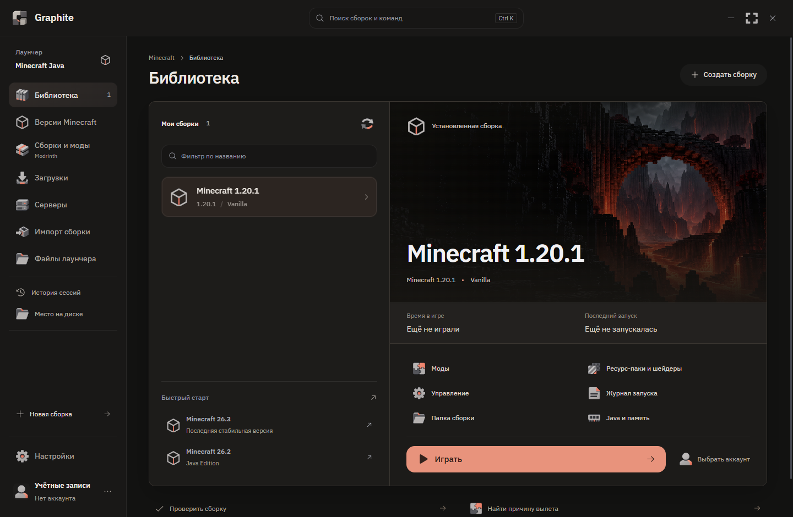
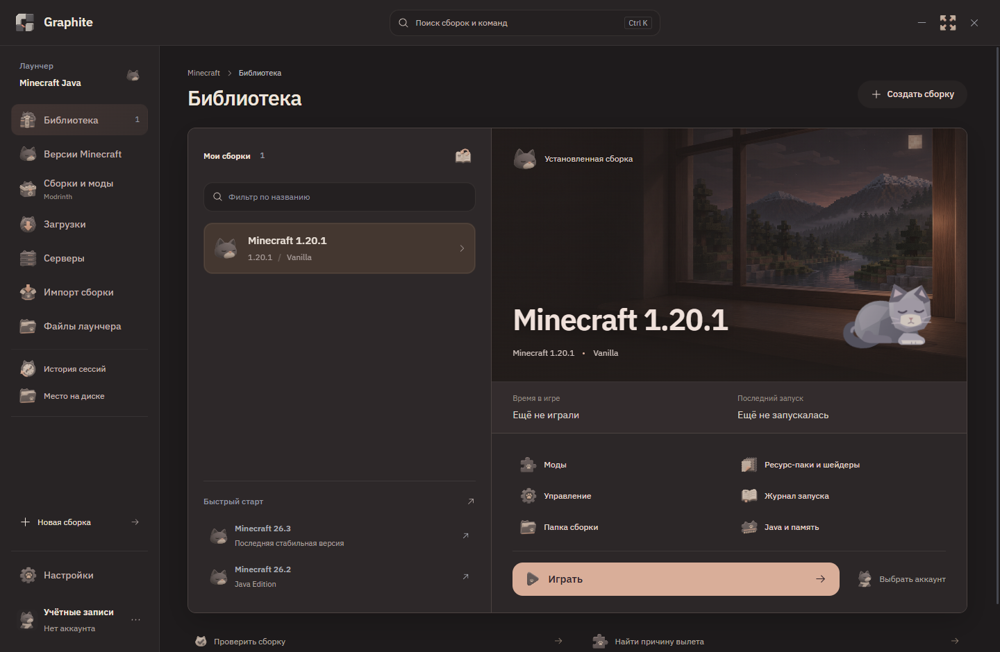

# Graphite Launcher

English | [Русский](README.ru.md)

Minecraft: Java Edition launcher for Windows. Separate instances, content from Modrinth and two themes: Graphite and Smoky.

[Download](https://github.com/minidream0/graphite-launcher/releases/latest) · [Issues and suggestions](https://github.com/minidream0/graphite-launcher/issues)

Smoky theme

## Features

- Separate instances with Minecraft version, mod loader, Java and memory settings.
- Microsoft sign-in and local profiles.
- Modpacks, mods, resource packs and shaders from Modrinth.
- Import `.mrpack` files and Prism instances, or drag files into the window.
- Mod management and backups of worlds and settings.
- Modpack updates in a separate copy with worlds and settings carried over.
- Favorite servers and joining with a selected instance.
- Logs, crash diagnostics, session history, download queue and disk cleanup.

## Install

Download and run the installer from the [release page](https://github.com/minidream0/graphite-launcher/releases/latest).

For the portable version, extract the archive and run `portable/Graphite.exe`. Keep `engine` beside it. When updating manually, keep the `data` folder containing your accounts, worlds and settings.

WebView2 is required. The installer downloads it if needed; for portable, install it separately.

## Development

Interface: React and Tailwind. Host: Rust/Tauri with system WebView2. Engine: modified Prism Launcher in C++.

[Build instructions](BUILD.md) · [Third-party components](THIRD-PARTY.md) · [Security](SECURITY.md)

## License

[GPL-3.0-only](LICENSE). Third-party components have their own licenses.

Graphite is based on [Prism Launcher](https://github.com/PrismLauncher/PrismLauncher). The modified engine source is included in this repository. Graphite is not an official product of Prism Launcher, Mojang or Microsoft.
