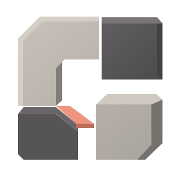
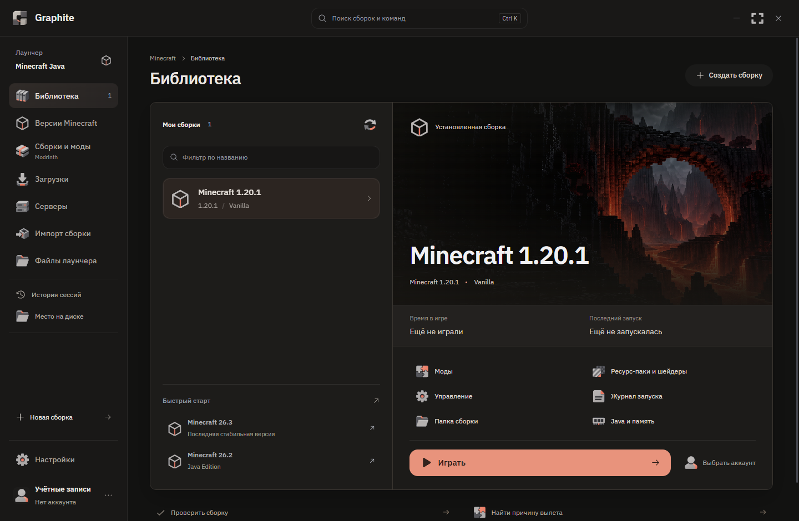
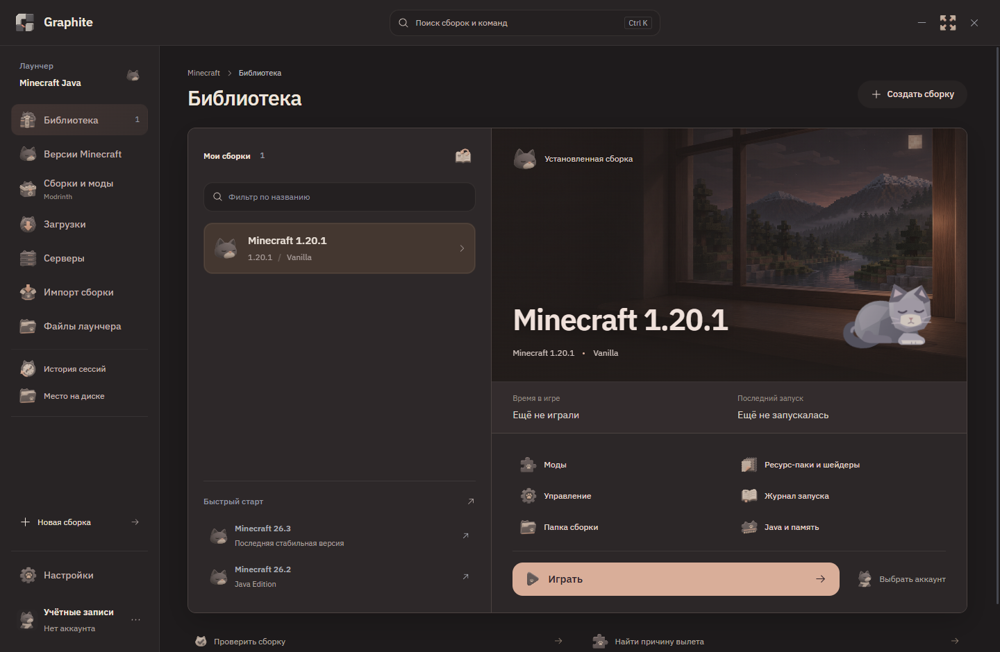

# Graphite Launcher

Graphite позволяет устанавливать и запускать Minecraft Java Edition, собирать модпаки и хранить несколько сборок в одной библиотеке. Лаунчер работает на Windows и использует движок Prism Launcher.

[Скачать для Windows](https://github.com/minidream0/graphite-launcher/releases/latest) · [English](README.md) · [GitHub Issues](https://github.com/minidream0/graphite-launcher/issues)

## Сборки и моды

Для каждой сборки выбираются версия Minecraft, загрузчик модов, Java и объём памяти. Ванильная игра и модпаки хранятся отдельно, со своими мирами и настройками. Сборки можно переименовывать, дублировать и менять им иконки.

В каталоге Modrinth доступны готовые модпаки, отдельные моды, ресурс-паки и шейдеры. Установленные моды можно включать и отключать, удалять и проверять на обновления. Папка сборки открывается прямо из лаунчера.

Готовую сборку можно перенести из Prism или импортировать из файла `.mrpack`. Поддерживается перетаскивание файлов: `.mrpack` и ZIP импортируют сборку, а `.jar` добавляет мод в выбранную сборку.

## Миры и обновления

Перед изменениями можно сохранить резервную копию миров и настроек. При обновлении модпака из Modrinth лаунчер показывает изменения и создаёт отдельную копию сборки с переносом миров и настроек. Старая сборка остаётся на месте.

За скачиванием файлов можно следить в очереди загрузок. В разделе управления диском видно, сколько места занимают файлы лаунчера.

## Аккаунты и серверы

Поддерживаются вход через Microsoft и локальные профили. Серверы можно добавлять в избранное, проверять их доступность и выбирать сборку для подключения.

Для сервера можно подготовить сборку с нужной версией игры и проверить её перед запуском.

## Логи и история

Логи запуска доступны в самом лаунчере. При сбое можно посмотреть сообщение об ошибке и скопировать лог. Диагностика помогает искать проблемы с Java, зависимостями и модами.

В истории сохраняются игровые сессии. По ней можно посмотреть, какие сборки запускались и сколько длилась игра.

## Оформление

В Graphite две темы. Основная использует тёмные графитовые оттенки, а «Дымчатый» оформлен в спокойных цветах с котом, отдельным артом и иконками.

Для запуска и установки есть объёмные анимации. Их количество можно уменьшить в настройках.

Посмотреть тему «Дымчатый»

## Установка

На [странице релиза](https://github.com/minidream0/graphite-launcher/releases/latest) доступны установщик и portable-архив для Windows x64.

Установщик подготовит лаунчер и загрузит WebView2, если его нет. Для portable-версии распакуйте архив и запустите `portable/Graphite.exe`. Папка `engine` должна оставаться рядом с EXE; WebView2 устанавливается отдельно.

Аккаунты, миры и настройки находятся в папке `data` рядом с Graphite.exe. При ручном обновлении сохраните её.

## Разработка

Интерфейс написан на React с Tailwind, оболочка на Rust/Tauri использует системный WebView2. За установку и запуск Minecraft отвечает изменённый движок Prism Launcher на C++. Его исходники входят в репозиторий.

[Сборка из исходников](BUILD.md) · [Сторонние компоненты](THIRD-PARTY.md)

Graphite основан на [Prism Launcher](https://github.com/PrismLauncher/PrismLauncher) и распространяется под [GPL-3.0-only](LICENSE).
